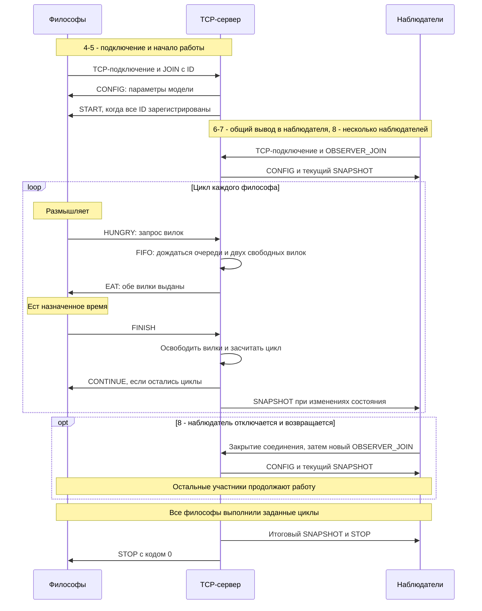
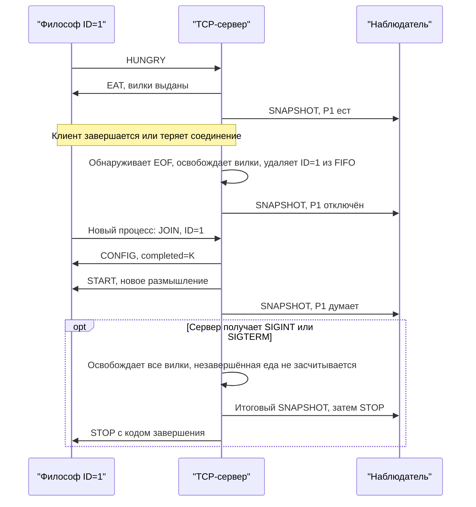

# Отчёт по заданию 4: вариант 5, «Обедающие философы»

Исполнитель: Пичурин Никита Андреевич. Группа: БПИ253.

## Условие и сущности программы

N равноправных философов за круглым столом чередуют размышление и еду.
Для еды нужны две соседние вилки. Нельзя одновременно выдать одну вилку двум
философам, допустить взаимную блокировку или бесконтрольное голодание.
Параметры: число философов, число циклов, диапазоны размышления и еды,
FIFO-стратегия, максимальное ожидание и общий лимит времени.

Реализация C11 для Linux использует libc и TCP-сокеты IPv4.
Сервер это самостоятельный процесс с неблокирующими сокетами и poll, он хранит
единственное достоверное состояние вилок, философов, завершённых циклов и FIFO.
Каждый философ - независимый процесс-клиент, сервер не запускает его через fork.
Размышление и еда - реальные ожидания в клиенте, во время них принимается STOP.
Каждый наблюдатель - независимая программа, которая только получает снимки.

Философ i (нумерация интерфейса 1..N) использует вилки i и i % N + 1.
Сервер выдаёт обе вилки одной операцией первому в FIFO. Если хотя бы одна занята,
следующая заявка не обходит первую. Несоседи могут есть одновременно.
Все философы выполняют одинаковый алгоритм, сервер служит арбитром ресурсов.

## Уровни требований

| Уровень | Реализация |
|---|---|
| 4–5 | TCP-сервер и независимые философы; IP/порт в CLI, локальные события |
| 6–7 | Отдельный наблюдатель показывает состояния всех философов и вилок |
| 8 | До 32 наблюдателей, динамические подключения/отключения |
| 8+ | Возвращение философов с сохранением завершённых циклов, STOP всем клиентам при завершении сервера |

## Полная схема работы

Схема объединяет базовое TCP-взаимодействие (4–5), общий вывод наблюдателя
(6–7) и несколько динамически подключаемых наблюдателей (8). Подключения наблюдателей могут происходить и в другие моменты.



TCP connect/accept устанавливают соединение, JOIN и CONFIG - уже сообщения
нашего протокола внутри него. На первоначальную регистрацию всех философов
отводится 60 секунд. Некорректный или занятый ID отклоняется, модель также может
закончиться по ошибке или лимиту вместо показанного успешного завершения.

Сервер хранит одну общую модель, наблюдатели её не изменяют. Каждый полный
SNAPSHOT содержит N кадров и выводится после их получения. На схеме философы
и наблюдатели сгруппированы по ролям, реализация допускает до 32 наблюдателей.
Блок отключения и возвращения
наблюдателя может выполняться в любой момент работающей модели, в том числе
между событиями внутри цикла. SNAPSHOT рассылается при изменениях состояния. Философы работают
параллельно, поэтому несоседи могут есть одновременно.

Возвращение
философов с сохранением прогресса и остановка клиентов при прерывании сервера
отдельно рассматриваются ниже.

## Схема уровня 8+ : обрыв, возвращение и остановка



Тут `K` - число циклов, которые сервер уже подтвердил через `FINISH`. Если связь
оборвалась во время еды, текущий цикл не входит в `K`, после возвращения философ
повторяет его. То есть модель не теряет прогресс при пересоздании процесса клиента.

## Протокол и проверки

Кадр содержит шесть uint32_t в сетевом порядке, всего 24 байта.
Типы и значения полей перечислены в README. TCP не сохраняет границы сообщений,
входной буфер накапливает кадр частями, исходящая запись отправляет остаток.
Передаются числа, а не сырые структуры с указателями. Проверяются версия, тип,
ID, диапазоны полей и допустимость перехода состояния. FINISH раньше назначенного
срока отклоняется. Данные философа привязаны к его TCP-соединению.

Новый философ получает CONFIG и START после сбора состава. HUNGRY ставит его в
FIFO, EAT разрешает еду, FINISH освобождает вилки. CONTINUE задаёт следующее
размышление. Все успешно завершённые циклы подтверждаются только сервером.
При возвращении CONFIG сообщает сохранённый счётчик, оборванная еда повторяется.
Возвращающийся философ начинает с размышления и при следующем голоде встаёт в конец FIFO.

Наблюдатель получает N кадров SNAPSHOT, по одному на ID, и выводит только целый
снимок. Снимки отправляются при регистрации, старте, голоде, выдаче вилок,
окончании еды, отключении и завершении. Владелец вилки 0 означает, что она свободна.

## Запуск и завершение

Команды сборки, параметры по умолчанию и запуск в отдельных терминалах приведены
в README. Для локального запуска используется 127.0.0.1.

На начальный состав даётся 60 секунд.
После старта отключение философа не останавливает сервер, его вилки освобождаются,
заявка удаляется. При time_limit=0 сервер может ждать возвращения бесконечно,
остановка пользователем остаётся доступной. Прерывание клиента закрывает его
соединение, остальные процессы продолжают работать.

Сервер при обычной остановке рассылает STOP, затем закрывает дескрипторы.
Клиенты при EOF также выходят, поэтому SIGKILL сервера не оставляет их ждать
данные из закрытого соединения.

## Проверка и результаты

```bash
cmake -S . -B build -DBUILD_TESTING=ON 
cmake --build build -j 4
ctest --test-dir build --output-on-failure
```

Проверяются реальные процессы, а также искусственные TCP-клиенты и сервер:
2/5 философов по три цикла, FIFO и владение вилками по выводу, несоседняя еда,
частичные/склеенные кадры, дубликат ID, ранний FINISH, неверные версия/ID,
таймаут состава, оба лимита, смерть сервера, возвращение клиента после SIGKILL,
обрыв во время еды после одного засчитанного цикла, три наблюдателя и их замена,
SIGTERM сервера с завершением всех подключённых программ.

Результаты последнего прогона сохранены в tests/results_4.txt. Вывод дочерних
процессов сохраняется в tests/logs/run-XXXXXX внутри проекта, путь к которому
печатает стенд. Каждый запуск создаёт отдельную папку, предыдущие логи
не перезаписываются.
